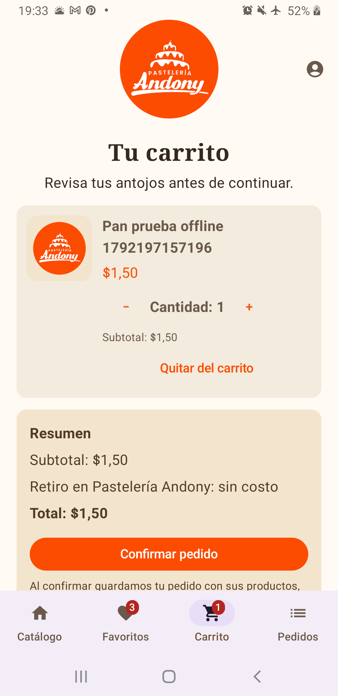
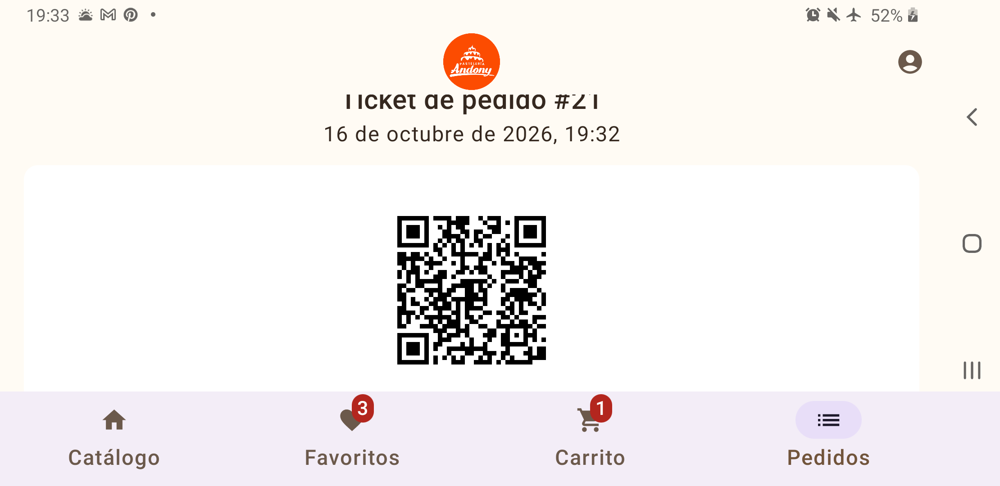

# Evidencias, versión y alcance de la entrega

Actualización: **18 de octubre de 2026 (America/Guayaquil, UTC−05:00)**.
Código revisado: **`28abdbda9100c8d56dec70e330f62a295863af43`** (`Implementar casos de uso (UseCases)`). Los cambios de esta entrega son documentales y todavía no tienen un commit propio; este hash identifica el código comprobado, no un commit futuro de documentación.

## Qué exige el criterio recibido

Fuente disponible: solicitud «Actualizar documentación y evidencias», prioridad **Media**, **sin puntos directos**: actualizar README y documentos técnicos con resultados de pruebas, capturas, fecha, commit y explicación de arquitectura; distinguir los requisitos de esta rúbrica de otras etapas.

No se ha aportado la rúbrica completa ni se encontró en los documentos del repositorio. Por tanto, no se asignan puntos, mínimos de tablas ni entregables adicionales a este criterio. La tabla delimita el texto recibido; no certifica el cumplimiento de toda la evaluación.

| Elemento | Tratamiento en esta actualización |
| --- | --- |
| README y explicación técnica | README enlaza esta evidencia; arquitectura actualiza Configuración, casos de uso, Hilt, estado y adaptación de ventanas. |
| Pruebas, fecha y commit | Resultados identificados por versión, diferenciando ejecución actual de registros históricos. |
| Capturas | Cinco imágenes reales de fase 4 indexadas abajo; faltan capturas de la interfaz del commit actual. |
| CRUD completo y mínimo de tablas | Antecedentes de otras etapas; no se deducen del criterio documental. El CRUD visual pendiente sigue declarado. |
| Word, comparación con Figma y evaluación DCU/TalkBack | Pendientes históricos o de validación; el texto recibido no exige un formato Word ni les asigna puntos. |
| Casos de uso y adaptación | Implementaciones ya presentes que se describen y verifican; no se les inventa una ponderación. |

## Verificación del código actual

Entorno: Windows, Gradle 9.5.0 local, JDK 25 solicitado por el proyecto, SDK de compilación 37; dependencias en caché, `--offline --max-workers=2`.

| Comprobación del 18/10/2026 | Resultado y alcance |
| --- | --- |
| `:app:assembleDebug` | BUILD SUCCESSFUL; tarea UP-TO-DATE, reutilizó la compilación vigente. |
| `:app:compileDebugAndroidTestKotlin` | BUILD SUCCESSFUL; UP-TO-DATE. Compilar pruebas no significa ejecutarlas en Android. |
| `:app:lintDebug` | BUILD SUCCESSFUL; análisis ejecutado: 0 errores y 24 advertencias. Véase informe adjunto. |
| `:app:testDebugUnitTest --rerun` | 22 aprobadas, 0 fallos, 0 errores, 0 omitidas. Repetición explícita; XML adjuntos. |
| Instrumentación y revisión visual | No se repitieron en esta actualización documental. Los resultados anteriores se conservan como históricos. |

La ejecución conjunta terminó con 66 tareas: 5 ejecutadas y 61 actualizadas. El wrapper intentó descargar Gradle y falló por acceso de red; se utilizó la distribución local 9.5.0 ya instalada. Esto no implica un fallo de las pruebas.

La repetición unitaria terminó con 32 tareas: 1 ejecutada y 31 actualizadas. Inicio XML: **01:15:05 UTC−05:00**. Distribución: AdaptiveLayoutTest 5, DemoAccountTest 2, MoneyTest 2, OrderModelTest 3, UseCasesTest 9 y ExampleUnitTest 1. Esta última es un caso de ejemplo; no se contabiliza como una funcionalidad de negocio cubierta.

Comandos reproducibles con Gradle/JDK/SDK disponibles:

```powershell
.\gradlew.bat :app:assembleDebug :app:compileDebugAndroidTestKotlin :app:lintDebug --offline --max-workers=2
.\gradlew.bat :app:testDebugUnitTest --rerun --offline --max-workers=2
```

Si el wrapper no está disponible, invocar `gradle.bat` de una instalación **9.5.0** con los mismos argumentos. `--offline` no evita la descarga inicial del propio wrapper. Para instrumentación, seguir [el guion y sus precauciones de restauración](DEMOSTRACION_OFFLINE.md).

Evidencia portable de esta revisión: [resumen](evidencias/2026-10-18/verificacion.txt), [lint](evidencias/2026-10-18/lint.txt) y XML de pruebas en `evidencias/2026-10-18/unitarias/`. Los informes originales de Gradle quedan en `app/build/reports/` y `app/build/test-results/`; esas rutas generadas no sustituyen los archivos adjuntos al repositorio.

## Capturas históricas disponibles

Fecha de ejecución documentada: **16/10/2026**. Dispositivo registrado: **Samsung SM-A750G, Android 10, USB**. Incorporadas al repositorio en **`744d104e500ae801cebdb4d9651e708f3de8d1c4`**. Este es el commit de incorporación; **el hash exacto del APK fotografiado no fue registrado**. No debe confundirse con el commit del código actual.

| Captura | Condición registrada y qué acredita |
| --- | --- |
| [Carrito offline](evidencias/fase4/phase4-offline-cart.png) | Vertical, fase offline: carrito pendiente después de detener y reabrir. Escala exacta de esta captura no registrada. |
| [Ticket offline](evidencias/fase4/phase4-offline-ticket.png) | Vertical, fase offline: pedido temporal #21, total $1,50 y QR. Escala exacta no registrada. |
| [Teclado](evidencias/fase4/phase4-keyboard.png) | Fase layout, fuente 150 %: búsqueda y teclado visibles. |
| [Carrito horizontal](evidencias/fase4/phase4-landscape-cart.png) | Horizontal, fuente 150 %: contenido y confirmación de la interfaz anterior. |
| [Ticket horizontal](evidencias/fase4/phase4-landscape-ticket.png) | Horizontal, fuente 150 %: QR de la interfaz anterior. |





Los colores, cabeceras y mensajes son anteriores a los cambios actuales. Estas imágenes no prueban NavigationRail, SettingsViewModel, distribución en varias columnas ni el aviso local nuevo del ticket. Una captura tampoco demuestra por sí sola persistencia, ausencia de red o decodificación del QR: esos resultados pertenecen al [registro de ejecución de fase 4](FASES_CORRECCION.md#verificación-final-del-16-de-octubre-de-2026).

## Resultados históricos y pendientes

- **16/10, fase 4:** 8 unitarias, 14 instrumentadas aprobadas y una omitida en la batería general; las fases offline se ejecutaron aparte. `OK (15 tests)` no equivale a 15 aprobadas. El registro original no identifica el hash exacto ejecutado.
- **17/10, `6dbb9ba`:** 8 unitarias, lint 0 errores/24 advertencias, según el registro de fase 5. No representa los casos de uso ni la adaptación posteriores.
- **18/10, casos de uso:** el documento original registra 22 unitarias y 6 casos Room aprobados en Samsung SM-A750G. La instrumentación no se repitió aquí y no se presenta como una ejecución nueva.

Para cerrar evidencia visual actual: capturar acceso, Configuración, catálogo compacto y ancho, carrito y ticket con aviso local. Registrar por imagen fecha/hora, commit del APK instalado, modelo/API, tamaño de ventana, orientación, fuente, pasos y resultado observado. Quedan pendientes TalkBack, contraste visual, comparación con Figma y evaluación con usuarios. Ninguno se declara aprobado por compilar o pasar pruebas unitarias.
